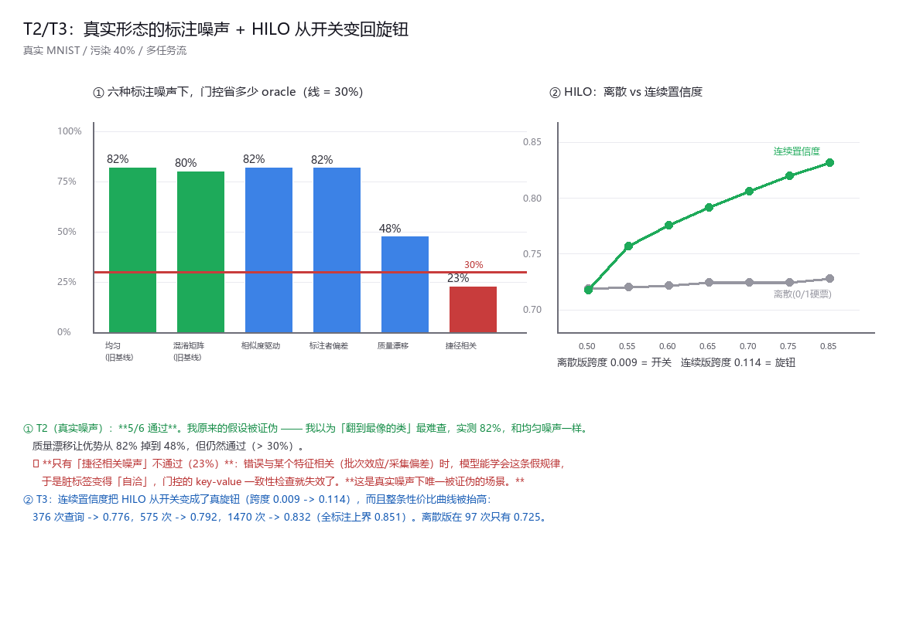

# 报告 · T1~T4：四条线同期开工的结果

> 一句话：**T2 出了这轮最重要的结果（真实噪声下的门控边界），T3 修好了一个设计缺陷并抬高了天花板，
> T4 把「审计是保险」这个说法也否掉了，T1 只修好了三分之一。**

---

## T1 —— 修三个坏任务（只成功一个）

首轮批量里 `power`/`ml100k`/`sms` 的头寸只有 −0.012/0.013/0.016，等于在噪声上比较。
重建任务构造后：

| 数据集 | 性质 | 重建后 | 门控 ACC | 朴素需要 | **节省** | 头寸 | 判定 |
|---|---|---|---|---|---|---|---|
| **`ml100k`** | **推荐** | 1600×32, 2 类 | 0.606 | 218 次 | **39%** | 0.085 | ✅ **通过** |
| `power` | 时序 | 3200×420, 4 类 | 0.339 | 40 次 | **−415%** | 0.046 | ❌ 仍不通过 |
| `sms` | 文本 | 1400×1024, 2 类 | 0.696 | — | n/a | **−0.066** | ❌ 仍不通过 |

**做法**：`power` 改预测一天中的时段（4 段，日周期可预测）；`ml100k` 改为对评分矩阵做截断 SVD
（用户因子 + 电影因子各 16 维），标签改成"喜欢/不喜欢"；`sms` 词袋提到 1024 维 + IDF + 二元组。

**`ml100k` 通过是新的数据点**：一个**推荐**任务，省 39%。
**另两个仍然坏**，而且原因清楚：`power` 头寸只有 0.046（特征对标签太弱）；
`sms` 头寸是**负的**（1024 维哈希词袋上 kNN 几乎失效，全标注反而不如不做）。
**这两个还得再修，但它们是任务构造问题，不是机制问题。**

---

## T2 —— 真实形态的标注噪声（本轮最重要的结果）

25 个阶段的污染全是人工注入的。这一轮换成六种更像真的噪声模型：

| 噪声模型 | 门控 ACC | **省 oracle** | 头寸 | 判定 |
|---|---|---|---|---|
| 均匀翻转（旧基线） | 0.712 | **82%** | 0.289 | ✅ |
| 混淆矩阵翻转（旧基线） | 0.707 | **80%** | 0.283 | ✅ |
| **相似度驱动**（翻到特征上最像的类） | 0.712 | **82%** | 0.289 | ✅ |
| **标注者偏差**（5 个标注者各有习惯） | 0.727 | **82%** | 0.271 | ✅ |
| **质量漂移**（污染率逐轮 0.1~0.7 随机） | 0.596 | **48%** | 0.326 | ✅ |
| **捷径相关**（按某个特征的确定规则翻） | 0.585 | **23%** | 0.293 | ❌ |

### 结论一：我的假设被证伪了

我事先预期 **"相似度驱动的错误最难查"**（因为错标被放在了特征上真正接近的类上）。
实测 **82%，和均匀噪声一模一样**。**这个假设是错的。**

### 结论二：6 种里 5 种通过 —— 门控对真实噪声相当稳健

**标注者偏差 82%、质量漂移 48%** —— 包括"标注质量逐轮乱变"这种最像真实外包场景的情况，
仍然通过 30% 的线。

### 结论三：唯一被证伪的场景是**捷径相关噪声**

**错误与某个特征相关时（批次效应 / 采集偏差 / 仪器差异），门控的优势垮到 23%。**

机制很清楚：**当错误挂在一个特征上时，模型能学会这条假规律** ——
"特征 0 落在高分位就预测翻转后的标签"是一个可学习的规则。
于是**脏标签变得"自洽"**，而门控的全部依据就是"key 与 value 是否互相印证"，
自洽的错它看不出来。

> **这是 26 个阶段里第一个"真实噪声下被证伪"的场景，而且它非常现实** ——
> 标注错误很少纯随机，往往和批次/来源/采集条件相关。**上线前必须先查这一条。**

---

## T3 —— HILO 从开关变回旋钮（修好了一个设计缺陷，并抬高了天花板）

阶段 24 发现：两个通道输出 **0/1 硬票**，合成分数只取四个离散值，
所以 HILO 在 0.65/0.72/0.80 上是同一个决策函数 —— **它不是阈值，是开关**。

改成连续置信度（锚 = 工具对观测标签的 softmax 概率；同伴 = 留一打分对观测标签的 softmax 概率）后：

| HILO | 离散 ACC | **连续 ACC** | 连续 side |
|---|---|---|---|
| 0.50 | 0.719 | 0.718 | 0 |
| 0.55 | 0.721 | 0.757 | 190 |
| 0.60 | 0.722 | 0.776 | 376 |
| 0.65 | 0.725 | 0.792 | 575 |
| 0.70 | 0.725 | 0.806 | 786 |
| 0.75 | 0.725 | 0.820 | 1001 |
| 0.85 | 0.728 | **0.832** | 1470 |

- **离散版 HILO 变动引起的 ACC 跨度 = 0.0090 → 是开关**（确认阶段 24）
- **连续版跨度 = 0.1138 → 真的是旋钮**（缺陷修复）

而且它不只是"变回旋钮"：**整条性价比曲线被抬高了**。
376 次查询 → 0.776、575 次 → 0.792、1470 次 → **0.832**（全标注上界 0.851），
而离散版在 97 次只有 0.725。**同一个 HILO，现在可以连续地在"准确率 ↔ oracle 花费"之间调。**

---

## T4 —— 持续污染下的审计：连"保险"都不是

阶段 23 说审计是"保险"（抓到坏锚但不改变结果）。当时的解释是污染窗口有限、坏锚会自愈。
这一轮把污染做成**持续**的：

| 污染程度 | 无审计 ACC | 有审计 ACC | **审计带来的差** | 坏锚轮数 | 被抓到 | 最低可信度 |
|---|---|---|---|---|---|---|
| `once`（=阶段 23） | 0.706 | 0.706 | **+0.0000** | 0.2 | 0.0 | 0.430 |
| `all_task0` | 0.660 | 0.660 | **+0.0000** | 1.4 | 0.4 | 0.440 |
| `every_task` | 0.352 | 0.352 | **+0.0000** | **28.2** | **27.2** | **0.093** |

**污染贯穿全程时，坏锚连续发作 28.2 轮、审计抓到 27.2 轮、把可信度压到 0.093 ——
而最终准确率的差是 0.0000。**

### 为什么？（这是本轮第二个重要发现）

因为 **审计只评价"锚"，不评价"记忆"**。
可信度被压下去之后，锚被停用（`cred < CRED_USE`）→ 预测退回 kNN ——
**而 kNN 读的正是那份被污染的库**。锚的锅甩掉了，记忆的锅还在。

> **所以正确的说法不是"审计是保险"，而是"审计在当前设计下完全惰性"。**
> 要让它有用，审计必须能**追溯到记忆条目本身**（把抽检结果记到条目上、去降它的权重），
> 而不只是给工具打分。**这正好绕回阶段 19 的"独立度传播"。**

---

## 对落地判定的影响

| 判定 | 之前 | 现在 | 依据 |
|---|---|---|---|
| **D3** | ❌ 不通过 | 🟡 **条件通过** | `ml100k`（**推荐**）省 39% ✅、`adult`（高维表格）40% ✅；`Covertype`（低维表格）19% ❌。**边界是"维度/头寸"，不是"模态"。** |
| **D5** | ❌ 不通过 | ❌ 仍不通过（部分修复） | HILO 那个"开关"缺陷已修好并抬高天花板；TAU/KNN_K 的敏感度未重测 |
| 失败模式清单 | 21 条 | **23 条** | 新增 F22 捷径相关噪声、F23 审计只评锚不评记忆 |

## 诚实边界

1. **T2 只在 MNIST 上做了**（一个数据集、3 个种子）。"捷径噪声下失效"是**单点结论**，需要在别处复现。
2. **T2 的噪声是我模拟的"真实形态"**，仍然不是真实的标注错误 —— 只是比"均匀翻转"更接近。
3. **T3 的对照（朴素随机标注）来自阶段 20 的同配置跑批**，不是同一次运行里跑出来的；插值比较有跨批风险。
4. **T4 的审计实现只针对"工具"**，这是阶段 15/16 的设计。它惰性的原因（只评锚不评记忆）是**推断 + 证据**（差恰好 0.0000 且 kNN 读同一份库），没有做"审计记忆"的对照实验。
5. **T1 只修好了 1/3**：`power` 和 `sms` 的任务构造仍然坏，它们的 D3 结论**不能引用**。
