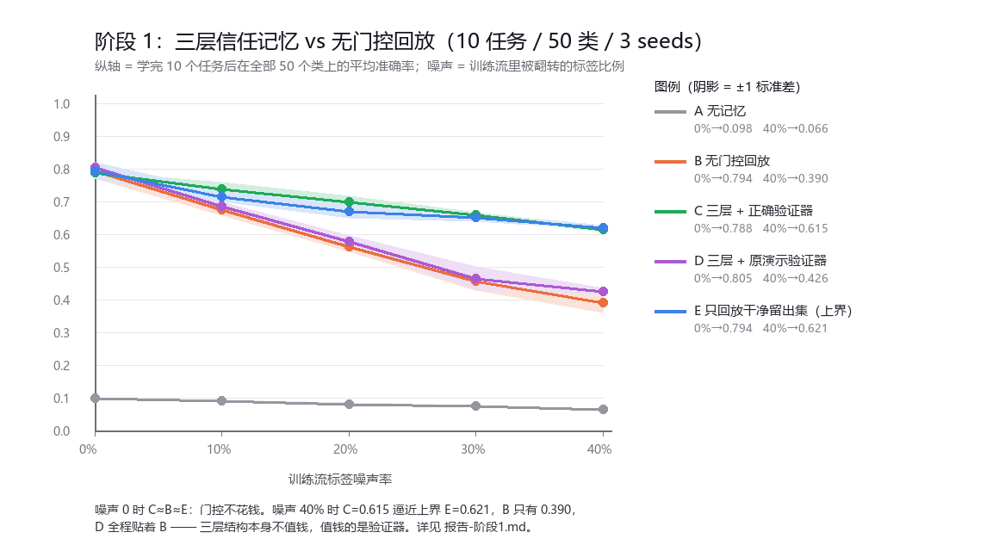
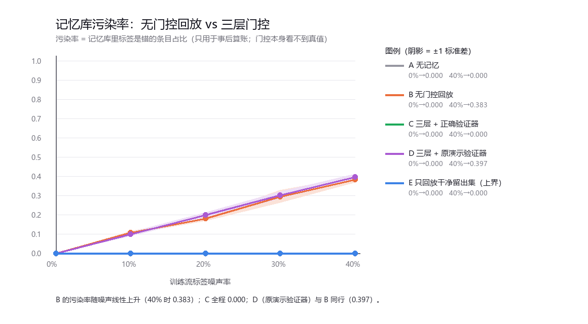

# 报告 · 阶段 1 —— 三层门控到底值不值钱？

## 问题

去掉原演示所有的装饰之后，只剩一个可以被证伪的命题：

> 在**带噪声的持续数据流**里，「只允许通过验证的知识进入长期记忆」，
> 比「照单全收地回放」更好吗？好多少？代价是什么？

## 设置

- **任务流**：class-incremental。10 个任务依次到达，每个任务 5 个全新的类（共 50 类），
  输入 20 维高斯簇原型 + 噪声。测试时**不给任务 id**，所以遗忘会非常显著。
  难度标定为 `center_scale=2.0, spread=1.8`（先扫过 4 档，选了 B 有 ~0.79 头顶空间的那档）。
- **噪声**：训练流里以概率 p 把标签翻成同类里的另一个类（= 人为制造的幻觉）；
  验证集/测试集标签**永远干净**。
- **模型**：纯 numpy MLP（20→128→64→动态扩头），Adam，每任务 300 个梯度步，batch 32。
  所有组共用同一份随机种子、同一个网络结构、同样多的梯度步与数据量。
- **5 组对照**：

| 组 | 记忆策略 |
|---|---|
| A `naive` | 无记忆，只学当前任务（遗忘下界） |
| B `replay` | 无门控回放，reservoir 采样，看到什么存什么 |
| **C `tiered_good`** | **三层信任记忆 + 看 key 的正确验证器** |
| D `tiered_demo` | 三层信任记忆 + 原演示那套只看 value 的验证器（反例） |
| E `clean_replay` | 直接只回放环境给的干净留出集（**上界**，不可部署） |

C 与 B 的差异**只有一处**：C 的温备只装通过验证的条目。容量都是 600，回放量都是每步 16 条，
淘汰策略都是对全历史均匀的 reservoir。

## 结果（10 任务 / 50 类 / 3 seeds，50 秒跑完）

准确率（学完全部任务后在 50 个类上的平均准确率）：

| 噪声率 | A 无记忆 | B 无门控回放 | **C 三层+正确验证器** | D 三层+原演示验证器 | E 干净留出集(上界) |
|---|---|---|---|---|---|
| 0% | 0.098±0.001 | 0.794±0.025 | 0.788±0.003 | 0.805±0.007 | 0.794±0.025 |
| 10% | 0.092±0.002 | 0.674±0.017 | **0.737±0.023** | 0.684±0.015 | 0.716±0.017 |
| 20% | 0.080±0.005 | 0.562±0.017 | **0.698±0.018** | 0.578±0.018 | 0.669±0.021 |
| 30% | 0.075±0.004 | 0.457±0.030 | **0.660±0.008** | 0.466±0.036 | 0.652±0.014 |
| 40% | 0.066±0.003 | 0.390±0.030 | **0.615±0.008** | 0.426±0.011 | 0.621±0.006 |

同时记录的记忆账本：

| 噪声率 | 组 | 遗忘量 BWT | 记忆污染率 | 门控拒收条数 |
|---|---|---|---|---|
| 0% | B | -0.159 | 0.000 | 0 |
| 0% | C | -0.164 | 0.000 | 546 |
| 40% | B | -0.200 | 0.383 | 0 |
| 40% | C | **+0.004** | **0.000** | 1497 |
| 40% | D | -0.185 | 0.397 | 0 |

## 三条结论

1. **门控是真的有用，而且增益随污染上升而变大。**
   噪声 0 时 C 与 B 打平（0.788 vs 0.794，差在噪声内）—— 门控不花钱；
   噪声 40% 时 C=0.615 vs B=0.390，**相对提升 58%**，而且 C 的遗忘量几乎为零（BWT +0.004）。

2. **价值全部来自验证器的质量，三层结构本身不值钱。**
   D 沿用原演示那套「只看 value 像不像已知答案」的验证器，全程紧贴 B
   （0.426 vs 0.390，污染率 0.397 vs 0.383）—— **三层变四层都行，验证器错了就等于没有**。
   这也解释了原演示为什么能打印出「错误率 0.00%」却什么都没做。

3. **门控把脏数据流净化到了「只回放干净数据」的水平。**
   40% 噪声时 C=0.615 已经贴着上界 E=0.621；10~30% 区间 C 甚至略高于 E。
   也就是说：**它没有被白付的 oracle 冤枉**，脏流里的额外信息确实被捞出来了。

## 诚实边界（这些别当成结论）

1. **数据是合成的**。20 维高斯簇，类之间相当可分；真实数据的幻觉是**结构化、与输入相关**的，
   不是这里的均匀随机翻转。噪声模型是下一步最该换掉的东西。
2. **C 要付 oracle 账单**：每个任务额外消耗 150 条带干净标签的留出样本（= 训练量的 50%）。
   B 一分钱不花。E 组存在的意义就是回答「既然有 oracle 为什么不直接用」——目前答案是
   C≈E，即**门控把脏流用出了干净池的效果，但没有超过它**。
3. **超参没扫**：容量 600、theta=0.7、sim_floor=0.5、topk=8、min_support=3 都是随手定的。
   尤其 theta 与 sim_floor 直接影响接受率与误拒率，**这是阶段 3 的第一件事**。
4. **8% 的误拒**：噪声 0 时 C 还拒掉了 546/3000 条干净条目，
   根因是 20 维下余弦阈值 0.5 偏严（高维度量崩塌）。目前有冗余数据兜着，
   但在小样本任务上这会变成真损失。
5. **只有 3 个种子**，标准差最大 0.036。跨种子结论稳，但单点差异别当真。
6. **「冷备」在阶段 1 里是空的**。也就是说：这一阶段验证的是**温备 + 门控**这一半，
   冷备作为「只读锚点」的作用（以及对它的更新规则）**还没被检验**——那是阶段 3。

## 下一步

- **阶段 2**：`NoisyOracleValidator` 把 oracle 噪声从 0 扫到 0.5，画出
  「oracle 可靠度 vs C 的收益」曲线，找出**门控开始亏本**的临界点；
  同时扫 oracle 预算（每任务 50/150/300 条标注），给出「每多标 100 条能换多少准确率」。
- **阶段 3**：冷备更新规则（冻结 / EMA / 阈值门控）、淘汰策略 ablation、
  theta 与相似度度量 ablation。
