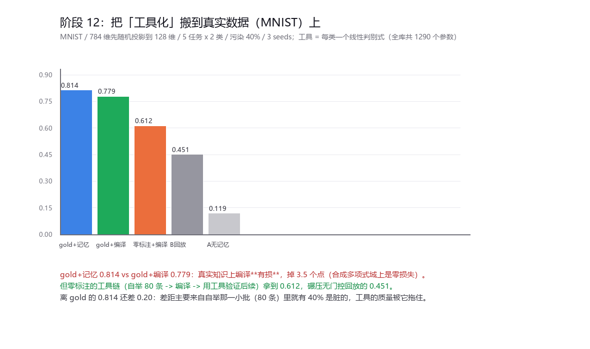
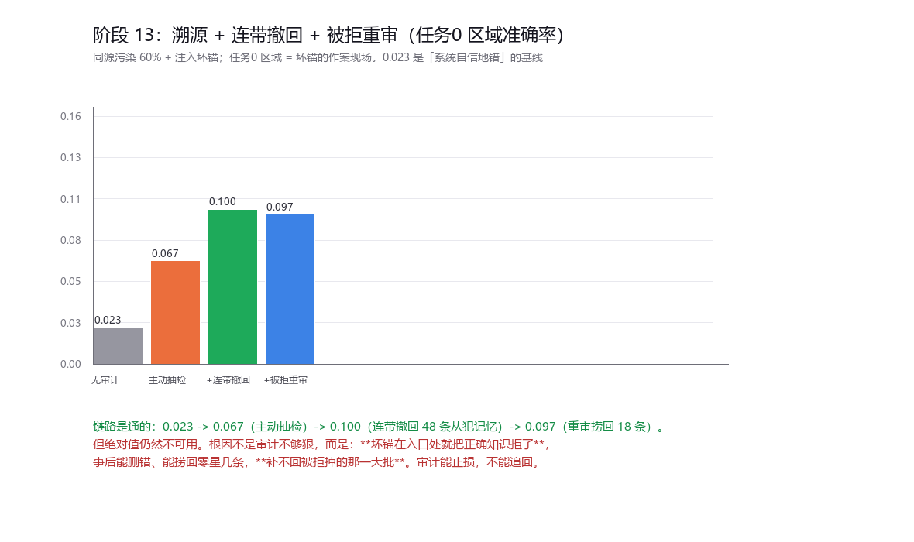

# 报告 · 阶段 12 / 13 —— 先测真实知识，再做溯源

## 阶段 12：把「工具化」搬到真实数据（MNIST）

阶段 10 的"编译成工具"是在**合成多项式域**上做的，那里编译是**无损**的 ——
一条稀疏多项式就是知识本身。真实图像显然不是。三个问题：
Q1 真实知识能编译成什么紧凑函数？Q2 编译损失多大？Q3 编译出来的函数能不能当免费验证通道？

**设置**：MNIST，784 维先做**固定的随机投影到 128 维**（所有组共用同一投影，组间比较仍然干净）。
5 任务 × 2 类，训练流污染 40%（结构化）。工具 = 每类一个**线性判别式**（岭回归 one-vs-rest）。

| 组 | 最终 ACC | gold 标注次数 | 说明 |
|---|---|---|---|
| **gold_mem**（gold 门控 + 记忆检索） | **0.814±0.005** | 2000 | 阶段 4 的基线 |
| **gold_tool**（gold 门控 + 编译，只用工具判定） | **0.779±0.009** | 2000 | 隔离 Q2 |
| **toolonly**（**零 gold**：自举 80 条 → 编译 → 用工具验证后续） | **0.612±0.024** | **0** | Q3 |
| B 无门控回放 | 0.451±0.023 | 0 | 参照 |
| A 无记忆 | 0.119±0.010 | 0 | 参照 |

1. **真实知识上编译是有损的**：0.814 → 0.779，掉 3.5 个点。
   合成多项式域上编译是零损失（阶段 10），这一步的差距就是"可编译性"的代价。
2. **但零标注的工具链在真实数据上能工作**：自举一小批 → 编译成工具 → 用工具验证后续，
   **一条 gold 标注都不花**，拿到 **0.612**，碾压无门控回放的 0.451（+0.16）。
3. **离 gold 还差 0.20**。差距的主要来源很清楚：自举那一小批（每任务前 80 条）里就有 40% 是脏的，
   工具的质量从一开始就被它拖住。**"自举那批有多干净"直接决定整条链的上限。**

---

## 阶段 13：污染溯源 + 连带撤回 + 被拒重审

阶段 11 发现：主动抽检能**发现**坏锚，但救不回准确率 —— 因为它只撤锚，不撤从犯。

**三轮机制依次加上去**（同源污染 60% + 注入坏锚的场景）：

| 组 | 总体 ACC | **任务 0 区域 ACC** | 降级坏锚 | 连带撤回 | 重审收下 |
|---|---|---|---|---|---|
| 无审计 | 0.527±0.082 | **0.023±0.017** | 0.0 | 0 | 0 |
| 主动抽检 | 0.531±0.139 | **0.067±0.012** | 2.3 | 0 | 0 |
| + 连带撤回 | 0.530±0.153 | **0.100±0.033** | 2.3 | 48 | 0 |
| + 被拒重审 | 0.529±0.156 | **0.097±0.042** | 2.3 | 48 | **18** |

- **链路是通的**：0.023 → 0.067（主动抽检）→ **0.100**（连带撤回 48 条从犯）→ 0.097（重审捞回 18 条）。
  连带撤回确实又推进了一步，说明"只撤锚不撤从犯"的判断是对的。
- **但重审没有进一步收益**，而且绝对值依然不可用。

### 为什么救不回来（这一轮最重要的判断）

不是因为审计不够狠，而是因为：**坏锚在入口处就把正确知识拒掉了。**
门控流程是"候选 → 锚一票否决 → 丢弃"，被拒的候选进了 hot 就被清空。
事后审计能删错、能通过重审捞回零星几条，**但补不回被拒掉的那一大批**。

> **审计能止损，不能追回。一个错误的锚造成的伤害是不可逆的。**

**由此得出的设计准则（比"加审计"更重要）**：
**不要让单个锚拥有否决权。** 要么否决需要多数同意，要么把被拒的候选放进"观察区"
而不是直接丢弃。这是下一个该做的东西 —— 而且它比审计更便宜，因为它在入口处就防住了。

---

## 诚实边界

1. **阶段 13 全程是合成域**（局部多项式），坏锚是**人为注入**的。
   真实数据上"系统自己编译出一个错锚"的完整过程没做。
2. 阶段 12 的"编译"就是**训练一个线性分类器**。这诚实但不惊艳 ——
   真正的问题是"知识压缩到多小还能保住多少精度"，而线性判别只是压缩方式里最简单的一种
   （原型、决策树、稀疏字典都没试）。
3. 阶段 12 表里的"保留样本数"两组都是 850，没有区分度 —— gold_tool 仍然在记录 accepted，
   只是判定不用它们，这一列在设计上没写清楚。
4. 阶段 12 的 toolonly 有"自举超参" BOOT=80 是**随手定的**，没扫；而结论恰好说
   "自举那批有多干净决定上限"，所以这个超参值得单独扫一次。
5. 阶段 13 的 0.100 / 0.097 只有 3 个种子、标准差 0.033~0.042，两个数字之间的差别没有意义。
6. 随机投影是**固定且共用**的，所以"128 维"不是任何一组的最优表示；它只保证组间可比。
