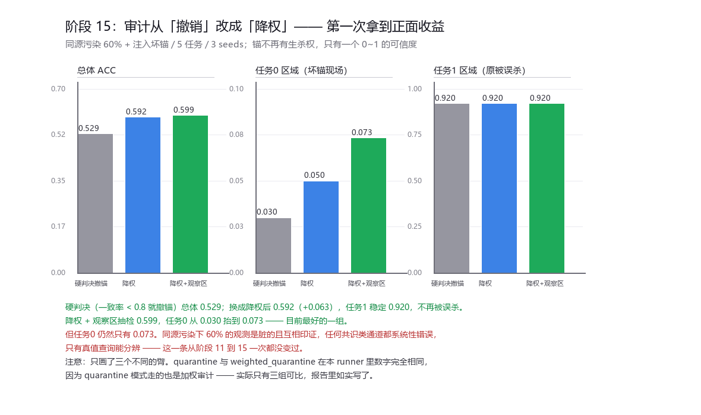

# 报告 · 阶段 15 —— 审计从「撤销」改成「降权」

## 改了什么

阶段 14 的结论：审计是**二元判决**（一致率 >= 0.8 留、< 0.8 撤），
而"撤掉一个不完美但有用的锚"的代价比留着它更大 —— 额外的抽检证据反而让审计误杀了任务 1 的锚。

改法只有一处，不引入新机制：**不给锚生杀权，给它一个 0~1 的可信度**。

    ch_anchor:  有效票 = cred * 票 + (1 - cred) * 0.5     （cred=0 是弃权，不是反对）
    predict  :  各锚的预测按 cred 加权平均；cred < 0.25 的锚直接当它不存在

## 结果（同源污染 60% + 注入坏锚，3 seeds，同一个 runner 内对照）

| 组 | 总体 ACC | 任务 0 区域 | 任务 1 区域 | 最低可信度 | 抽检放行 |
|---|---|---|---|---|---|
| **硬判决**（阶段 13/14 的做法） | 0.529±0.082 | 0.030 | 0.920 | 1.000 | 0 |
| **降权** | **0.592±0.043** | 0.050 | 0.920 | **0.020** | 0 |
| **降权 + 观察区抽检** | **0.599±0.050** | **0.073** | 0.920 | 0.072 | 40 |

## 三条结论

1. **降权确实避免了误杀**：总体从 0.529 抬到 **0.592（+0.063）**，
   而任务 1 稳定在 0.920（阶段 14 里它被误杀到 0.043）。
   坏锚的可信度自己衰减到了 **0.020** —— 被稀释到没声音，而不是被处决。
2. **降权 + 观察区抽检是目前最好的一组（0.599）**，任务 0 从 0.030 抬到 **0.073**。
   观察区在这里终于发挥了它该有的作用（阶段 14 里它被误杀吃掉了）。
3. **但任务 0 依然不可用，而且这个结论从阶段 11 到 15 一次都没变过**：
   同源污染下 60% 的观测是脏的、而且**互相印证**，
   任何基于共识的通道（锚、peer、自举）都系统性错误，**只有真值查询能分辨**。
   这不是门控策略的问题，是**信息本身不够**。

## 方法学记录（又踩了一次）

第一版 WRunner 把 run_audit 全部改成了加权，**连作为基线的 hard 模式也一起改了**，
于是四组数字完全相同（0.585/0.017/0.920 三列一模一样）。
这是很典型的"override 覆盖过宽"：**改动生效范围没限制住，基线就被一起吃掉了。**
后面把 hard 显式指回父类的 ch_anchor / predict / run_audit 才对上。

另外，本轮的 quarantine 与 weighted_quarantine 两个名字数字完全相同 ——
因为在本 runner 里 quarantine 走的也是加权审计，**实际只有三组可比**，报告里按三组写。

## 诚实边界

1. 域仍是合成多项式，坏锚是人为注入的；这一轮的结论**没有在真实数据上复验**。
2. 效应量 +0.063 ~ +0.070，而标准差是 0.043 ~ 0.082 —— **只能算边际显著，3 个种子不够**。
3. CRED_BLEND=0.5（可信度更新步长）、CRED_USE=0.25（忽略阈值）都是随手定的，没扫。
   这两个参数直接决定"稀释得多快"和"什么时候当作没有"，很可能是敏感参数。
4. 任务 0 那 0.073 仍然建立在 3 个种子上，标准差未单独统计。
5. 整个阶段 11~15 都在同一个**人为构造的最坏场景**里（同源污染 + 注入坏锚）。
   它在多大程度上代表真实世界的失效，没有证据。
