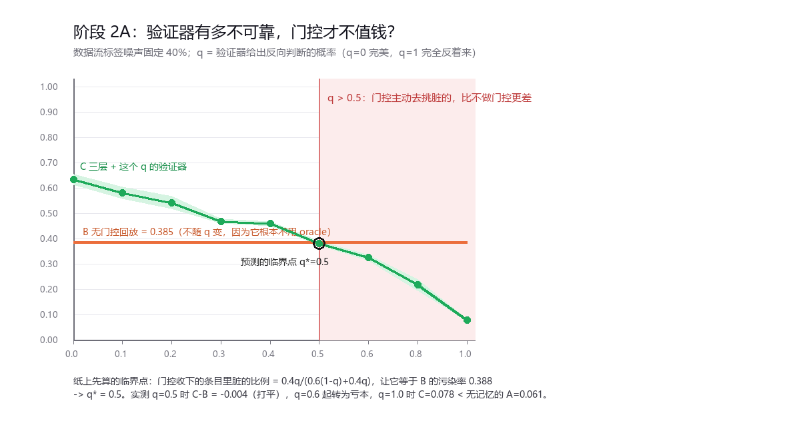
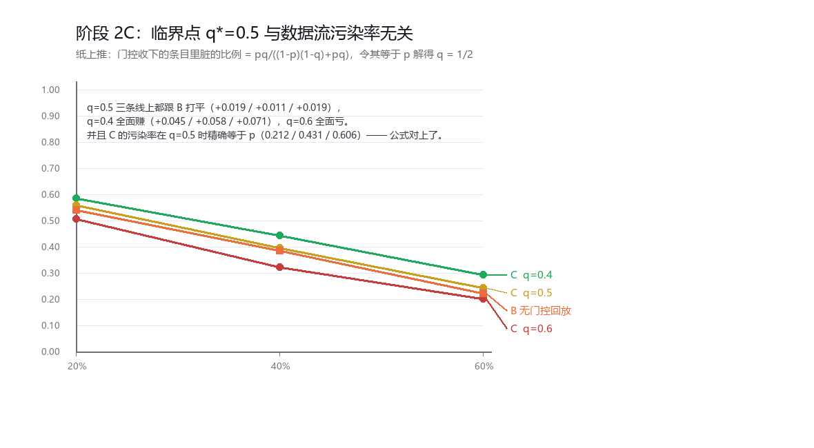
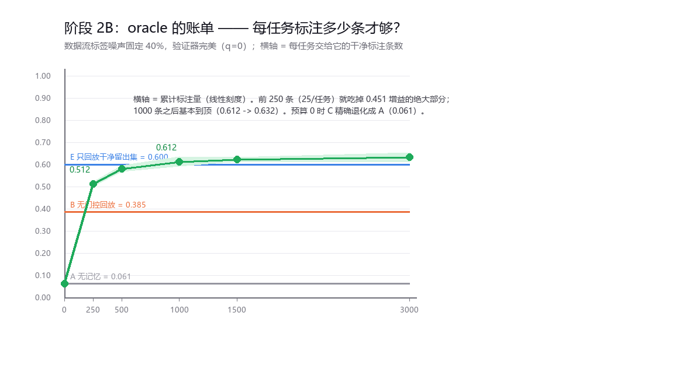

# 报告 · 阶段 2 —— oracle 的账单

## 问题

阶段 1 得出一条不太好听但很硬的结论：**这套三层记忆的价值 100% 来自验证器的质量**。
那么必须回答的是：

1. 验证器要多可靠，门控才开始**亏本**？（扫描 A / C）
2. 验证器要花多少钱？每任务标多少条才够？（扫描 B）

数据流标签噪声固定 40%（最考验门控的一档），10 任务 / 50 类 / 3 seeds，其余设置同阶段 1。

---

## 扫描 A：验证器有多不可靠，门控才不值钱？

被扫的是 **q = 验证器给出反向判断的概率**（`NoisyOracleValidator` 以概率 q 把 `s` 变成 `1-s`）。
q=0 完美，q=0.5 等于抛硬币，q=1 完全反着来。

| q | B 无门控回放 | C 三层+这个 q 的验证器 | C − B | C 的记忆污染率 |
|---|---|---|---|---|
| 0.0 | 0.385±0.022 | **0.632±0.021** | **+0.248** | 0.000 |
| 0.1 | 0.385 | 0.580±0.024 | +0.196 | 0.076 |
| 0.2 | 0.385 | 0.541±0.025 | +0.156 | 0.158 |
| 0.3 | 0.385 | 0.468±0.009 | +0.083 | 0.241 |
| 0.4 | 0.385 | 0.458±0.009 | +0.074 | 0.331 |
| **0.5** | 0.385 | 0.381±0.009 | **−0.004** | 0.419 |
| 0.6 | 0.385 | 0.324±0.012 | −0.060 | 0.528 |
| 0.8 | 0.385 | 0.216±0.022 | −0.168 | 0.723 |
| 1.0 | 0.385 | **0.078±0.003** | −0.306 | 0.954 |

B 那条线不随 q 变化，因为它根本不用 oracle。

**q=1.0 时 C=0.078，比完全无记忆的 A=0.061 还差。** 一个反向的验证器不只是没用，
它会让门控**主动去挑脏数据**——这比不做门控更糟。

---

## 扫描 C：先推后验 —— 临界点与污染率无关

在看数据之前先把公式写下来。设数据流污染率 p、验证器反向率 q，
门控收下的条目里脏的比例（假设验证器输出近似二值）：

    P(脏 | 被收下) = pq / ( (1-p)(1-q) + pq )

令它等于**不做门控时的污染率 p**：

    pq = p[(1-p)(1-q) + pq]
    q  = (1-p)(1-q) + pq
    q(1 + 1 - p - p) = 1 - p
    q = 1/2

**与 p 无关。** 也就是说：只要验证器的错误率低于 50%，这套门控就不会比不做门控差。

实测（p × q 各三档）：

| 污染率 p | B 的 ACC | B 的污染率 | C(q=0.4) | C(q=0.5) | C(q=0.6) |
|---|---|---|---|---|---|
| 20% | 0.541 | 0.202 | **+0.045** | +0.019（打平） | −0.034 |
| 40% | 0.385 | 0.388 | **+0.058** | +0.011（打平） | −0.063 |
| 60% | 0.223 | 0.604 | **+0.071** | +0.019（打平） | −0.021 |

（表中 C 列为 C−B 的准确率差。）同时 C 的**污染率**在 q=0.5 时精确落回 p：

| p | C 在 q=0.5 时的污染率（实测） | 公式给出的值 |
|---|---|---|
| 0.2 | 0.212 | 0.200 |
| 0.4 | 0.431 | 0.400 |
| 0.6 | 0.606 | 0.600 |

公式对上了，临界点也确实**不随污染率移动**。

**这条就是这套架构的"验证器合格线"：错误率 < 50% 就不亏，越接近 0 越赚。**
（前提见「诚实边界」第 2 条。）

---

## 扫描 B：oracle 要花多少钱？

固定完美验证器（q=0），扫"每任务交给它的干净标注条数"。

| 每任务标注 | 累计标注 | C 的 ACC | 相对上一档的增益 | 门控拒收条数 |
|---|---|---|---|---|
| 0 | 0 | 0.061±0.001 | — | 3000 |
| 25 | 250 | 0.512±0.011 | **+0.451** | 2217 |
| 50 | 500 | 0.581±0.014 | +0.069 | 1833 |
| 100 | 1000 | 0.612±0.022 | +0.031 | 1599 |
| 150 | 1500 | 0.622±0.010 | +0.010 | 1525 |
| 300 | 3000 | 0.632±0.021 | +0.010 | 1447 |
| 参照 A 无记忆 | 0 | 0.061 | | |
| 参照 B 无门控回放 | 0 | 0.385 | | |
| 参照 E 只回放干净留出集 | 1500 | 0.600 | | |

- **预算 0 时 C 精确退化成 A（0.061 vs 0.061）** —— 门控不会凭空产生能力，
  它只是把已有的 oracle 能力转换成抗污染能力。这是一个很好的正确性检查。
- **25 条/任务就已经远超无门控回放**（0.512 vs 0.385）。
- **100 条/任务基本到顶**（之后 5 倍标注只换来 +0.020）。
- 到 1500 条（= 阶段 1 用的量）时 C=0.622，已经超过"只回放干净留出集"的 E=0.600。

---

## 三条结论

1. **门控有一条极简的合格线：验证器错误率 < 50%。** 这条线可以从公式推出来，
   也实测出不随数据污染率移动。超过它，门控比不做更差；q=1 时甚至比完全无记忆更差。
2. **oracle 的边际收益衰减极快。** 25 条/任务拿走大部分收益，100 条/任务到顶。
   这套架构要的不是"很多标注"，而是"一点点对的标注"。
3. **门控不产生能力，只转移能力。** 预算为 0 时它精确退化成无记忆。它的作用是把
   "昂贵但不稳定的监督信号"变成"抗污染的记忆"。

---

## 诚实边界

1. **还是合成数据**，噪声仍然是均匀随机翻转，不是真实幻觉（结构化、与输入相关）。
2. **q* = 0.5 这个结论有前提**：它假设验证器输出近似二值（干净->1、脏->0），
   且失效方式是**对称翻转**（`1-s`）。真实的弱验证器更可能是"置信度普遍偏低"或
   "只在某些区域失效"，那会得到不同的临界点。这条公式是**这个失效模型下**的结论。
3. **预算扫描用的是"每任务前 b 条留出样本"**，不是随机子采样，可能引入轻微顺序偏差。
4. **只有 3 个种子**，标准差最大 0.035。
5. **还没测**：污染率 p 与可用标注量的交互（p 越大是否越值得多标注）；
   非对称失效的验证器。

## 下一步（阶段 3）

- **冷备更新规则**：冻结 / EMA / 阈值门控——冷备到目前为止一直是空的，
  "只读锚点"这一半的构想到了阶段 3 才真正接受检验。
- **淘汰策略 ablation**（reservoir / newest / score）与阈值 theta、
  相似度度量（余弦 vs 欧氏）的 ablation。
- 顺带修掉阶段 1 发现的 **18% 误拒**（高维余弦度量崩塌）。
