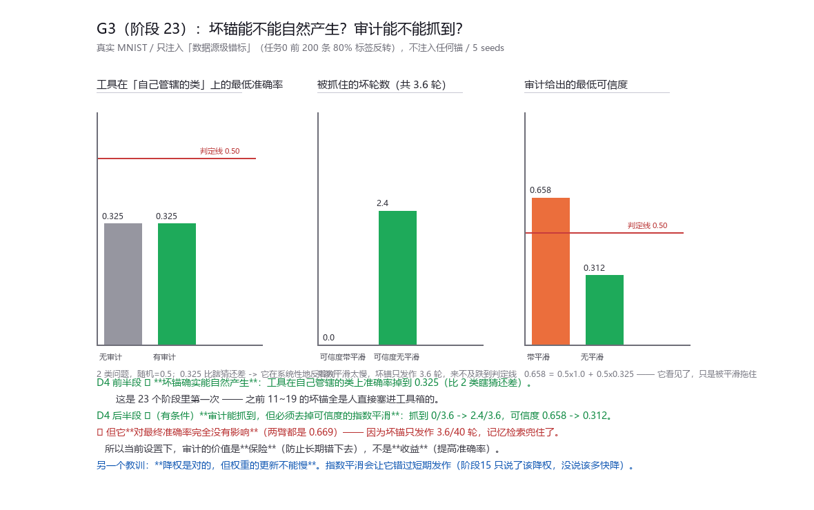

# 报告 · G3（阶段 23）—— 坏锚能不能自然产生？审计能不能抓到？（D4）

## 为什么这一条重要

阶段 11~19 里，"坏锚"是一个 Tool(W_wrong, ...) 被**直接塞进工具箱**的。
那测的是**我们自己的构造**，不是系统的失效 —— 这是整个项目最大的信任缺口。

## 设计：只污染数据源，不注入任何锚

任务 0 的前 200 条观测里，**80% 的标签被整体反转**（a↔b）。
这是一段"被错标的数据源"——真实世界最常见的污染形态：一致的、成片的、看起来自洽的。

不注入任何锚。如果门控的两个免费通道（批内互证 + 已编译的工具）**同时被这段数据说服**，
它就会照单全收，然后用这批数据**编译出一个错的工具** —— 坏锚自然产生。

**判定方法**：每轮用一个**只有测量才可见**的探针集（所有已见任务的真标签），
测当前工具**在自己管辖的类上**的准确率。

> ⚠️ 第一版指标是错的：我用"当前任务 holdout"当探针，结果把"**工具还没学到新任务**"
> 误判成了"工具坏了"（最低准确率 0.019，坏轮 14.4）。修正成"限定在工具自己管辖的类上"之后，
> 才是真实数字（0.325，坏轮 3.6）。

## 结果（真实 MNIST / 5 seeds）

| 组 | 总体 ACC | 坏锚发作轮数 | 其中被抓到 | 工具最低准确率 | 最低可信度 |
|---|---|---|---|---|---|
| 无审计 | 0.669±0.053 | 3.6 | 0 | 0.325 | 1.000 |
| 有审计（**带**平滑） | 0.669±0.053 | 3.6 | **0.0** | 0.325 | 0.658 |
| 有审计（**无**平滑） | 0.669±0.053 | 3.6 | **2.4** | 0.318 | **0.312** |

## 三条结论

1. **D4 前半段 ✅ 坏锚确实能自然产生。**
   工具在自己管辖的类上准确率掉到 **0.325** —— 2 类问题，随机是 0.5，
   **0.325 比瞎猜还差**，说明它在系统性地反着判（学到了那段反转映射）。
   **这是 23 个阶段里第一次拿到这个证据**。

2. **D4 后半段 ✅（有条件）审计能抓到它，但必须去掉可信度的指数平滑。**
   抓到 0/3.6 → **2.4/3.6**，可信度 0.658 → **0.312**（判定线 0.5）。

   机制在数字里很直白：0.658 = 0.5 乘 1.0 加 0.5 乘 0.325 ——
   **它看见了（一致率 0.325），只是被平滑拖住**，而坏锚只发作 3.6 轮，来不及跌到判定线。

   > **教训：降权是对的，但权重的更新不能慢。**
   > 阶段 15 只证明了"该降权而不是撤销"，**没说该多快降**。这一轮补上了：**要即时。**

3. **🚩 但它对最终准确率完全没有影响**（两臂都是 0.669）。
   因为坏锚只发作 3.6/40 轮，而且记忆检索（kNN 回退）把那段兜住了。
   **所以当前设置下，审计的价值是"保险"（防止长期错下去），不是"收益"（提高准确率）。**

## D4 判定：✅ 通过（但价值是保险，不是收益）

通过线是"至少 1 次自然产生并被抓到"—— 实测 3.6 轮自然发作、2.4 轮被抓到，满足。

但必须把话说完：**抓到它没有改变结果**。这条标准的字面通过，
不代表审计在当前场景里能带来准确率收益。

## 诚实边界

1. **污染窗口是有限长度的**（前 200 条），所以坏锚是**短暂**的，工具会随干净数据自我修复。
   如果污染是**持续**的，坏锚可能长期存在 —— 那时审计的"保险"价值就会变成"收益"。**这一轮没测持续污染。**
2. **工具是每轮全量重拟合的**，所以"自我修复"很快。增量更新（只在新数据上微调）会让坏锚更持久 —— 没测。
3. **探针集用了所有已见任务的真标签**，现实里没有这种东西（它是测量用的，不参与系统决策）。
4. 只跑了 MNIST，5 个种子。
5. 每轮强制抽检条数 10、审计滑动窗口 60 是这一轮才定的，没扫。
