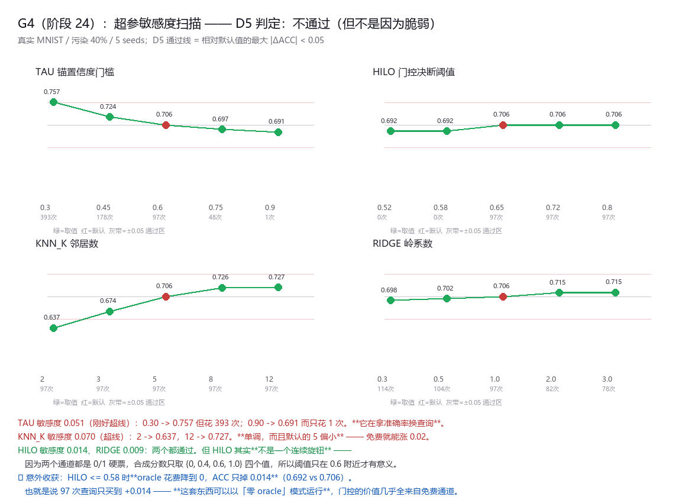

# 报告 · G4（阶段 24）—— 超参敏感度扫描：D5 不通过，但不是因为脆弱

## 为什么必须做

到阶段 23 为止，**所有关键超参都是随手定的，而且从没扫过**。
一个"调一调就崩"的机制不能上线 —— 用户不可能知道我们手气好。

## 扫哪四个

只扫**用户真正要自己设**的四个（都在部署路径上）：

| 参数 | 含义 | 默认 |
|---|---|---|
| TAU | 锚的置信度门槛：softmax 置信度超过它才算"管得着 x" | 0.60 |
| HILO | 门控决断阈值：score >= HILO 收，<= 1-HILO 拒，中间才花 oracle | 0.65 |
| KNN_K | 记忆检索的邻居数（工具不覆盖时的回退） | 5 |
| RIDGE | 线性工具的岭系数 | 1.0 |

判定：**敏感度 = 相对默认值的最大 |ΔACC|**，D5 通过线 < 0.05。

## 结果（真实 MNIST / 污染 40% / 5 seeds）

| 参数 | 取值 → ACC（oracle 花费） | 敏感度 | 判定 |
|---|---|---|---|
| **TAU** | 0.30→0.757(393) / 0.45→0.724(179) / **0.60→0.706(97)** / 0.75→0.697(49) / 0.90→0.691(**1**) | **0.051** | ❌ 不通过 |
| **KNN_K** | 2→0.637 / 3→0.674 / **5→0.706** / 8→0.726 / 12→**0.727** | **0.070** | ❌ 不通过 |
| HILO | 0.52→0.692(0) / 0.58→0.692(0) / **0.65→0.706(97)** / 0.72→0.706 / 0.80→0.706 | 0.014 | ✅ 通过 |
| RIDGE | 0.3→0.698 / 0.5→0.702 / **1.0→0.706** / 2.0→0.715 / 3.0→0.715 | 0.009 | ✅ 通过 |

**D5 判定：❌ 不通过**（TAU 0.051 与 KNN_K 0.070 超过 0.05 的线）。

## 但失败的方式要说清楚：不是脆弱，是默认值没选好

两个"不通过"的参数全是**单调、可解释**的走向，不是乱跳：

1. **TAU 是在拿准确率换查询**：0.30 时 ACC 0.757 但要花 393 次查询；
   0.90 时只花 **1 次**查询，ACC 还有 0.691。**这是一个连续的性价比旋钮，不是敏感点。**
2. **KNN_K 单调偏好更大的值**，而默认的 5 **偏小**。改成 8~12 是**免费**涨 0.02。

所以正确的结论是：**跑一次这个扫描就能标定**，推荐值：

    TAU     0.45 ~ 0.60（想省查询就往 0.75 走，想准就往 0.30 走）
    HILO    只要 > 0.60 就行（见下，它其实是个开关不是旋钮）
    KNN_K   8 ~ 12
    RIDGE   0.5 ~ 3.0 都行

## 🚩 顺带挖到两件更重要的事

### 1. HILO 其实不是连续旋钮，是个开关

两个通道给出的都是 **0/1 硬票**，所以合成分数只会取 **{0, 0.4, 0.6, 1.0} 四个离散值**。
于是"犹豫区"（区间 (1-HILO, HILO)）只有在 **HILO > 0.60** 时才可能命中 ——
HILO <= 0.58 时它永远为空。

这就是为什么 HILO 在 0.65/0.72/0.80 三档上 ACC 完全一样（0.706）：**这三档是同一个决策函数。**

> **设计缺陷**：想让 HILO 变成真正的连续旋钮，得让两个通道输出**连续的置信度**
> 而不是 0/1 硬票。这一轮没做，但它是明确的改进点。

### 2. 🔎 零 oracle 模式：97 次查询只买到 +0.014

HILO <= 0.58 时 **oracle 花费降到 0，ACC 只掉 0.014**（0.692 vs 0.706）。

**也就是说：这套东西可以完全不花标注地运行，代价只有 1.4 个点。**
反过来说，**门控的准确率几乎全部来自两个免费通道**（批内留一互证 + 已编译的工具），
oracle 只是用来买最后那一点点。

这条对落地很关键：现实中 oracle 是最贵、最慢、最不可得的一环，
而现在我们知道**它可以是可选的**。

## 诚实边界

1. **一维扫描（one-at-a-time）**，没测参数之间的交互。TAU 与 KNN_K 都在控制"回退到记忆"的比例，它们很可能有交互。
2. **只在 MNIST + 污染 40% + 无坏锚这一种场景下扫的**。换场景（有坏锚、持续污染、不同污染率）最优值会变。
3. HILO 的扫描点（0.52~0.80）比较窄，因为它本质上只有两档行为；更细的扫描没有意义。
4. 5 个种子，标准差 0.025~0.036。敏感度 0.051 与 0.070 和标准差同量级 —— **TAU 的那个"不通过"可能是噪声**。
5. RIDGE 与 KNN_K 的最优值都在扫描区间的**边界附近**（KNN_K=12 是上界），可能还能更好，没往外扩。
