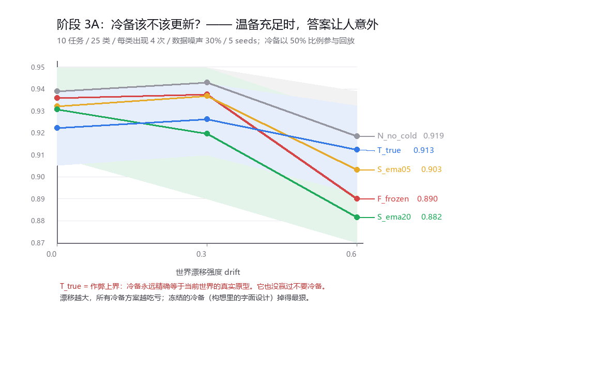
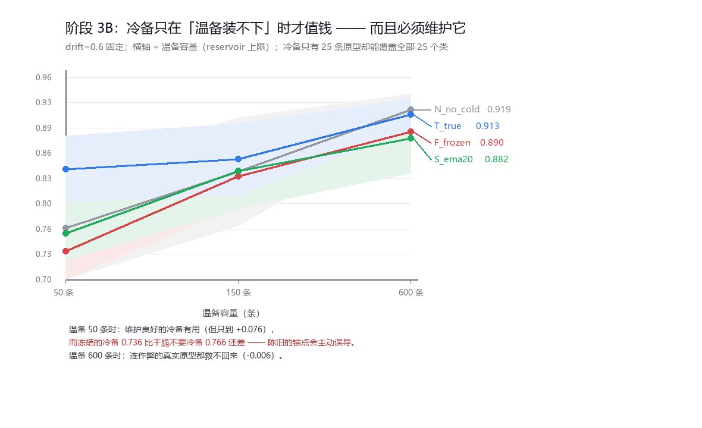

# 报告 · 阶段 3 —— 冷备到底该不该更新？

## 为什么这一阶段才轮到冷备

阶段 1/2 里冷备一直是**空的**，而且更新规则**根本触发不了**：class-incremental 每个类只出现一次，
"同一个类第二次被观测到"这件事从来不会发生。

而构想里最悬而未决的一条恰恰是（原对话最后一句）：

> 冷备份永远不变吗？若不进化，是否永远回滚到原始状态？

要回答它，必须先让**同一个类反复出现**，并且让**世界本身在移动**。所以阶段 3 新加了一条流
（`exp/recurring.py`）：25 个类 / 10 个任务 / **每个类出现 4 次**；每个任务结束后，
所有类的原型都随机走一步（drift）。测试用**漂移之后**的原型生成，也就是"当前世界的真值"。

五组，全部共用同一套已验证有效的「温备 + 验证门控」，唯一变量是冷备：

| 组 | 冷备的行为 |
|---|---|
| N_no_cold | 空着（阶段 1/2 基线） |
| F_frozen | 类第一次被验证通过时的原型，之后**一个字都不改**（构想里的字面设计） |
| S_ema05 / S_ema20 | 同一类的原型按 alpha=0.05 / 0.20 缓慢吸收新观测 |
| **T_true** | **作弊上界**：冷备永远精确等于当前世界的真实原型（模型不可能做到） |

T_true 这一组是这次最要紧的一步：它回答的不是"我们的冷备好不好"，而是
**"冷备这个东西本身到底有没有用"**。如果连作弊都赢不了，后面就没得谈了。

---

## 3A：温备充足（600 条）时，答案让人意外

| 漂移 | N 无冷备 | F 冻结 | S_ema05 | S_ema20 | T 真实原型（作弊） |
|---|---|---|---|---|---|
| 0.0 | **0.939±0.021** | 0.936±0.015 | 0.932±0.025 | 0.931±0.022 | 0.922±0.017 |
| 0.3 | **0.943±0.020** | 0.938±0.011 | 0.937±0.007 | 0.920±0.030 | 0.926±0.016 |
| 0.6 | **0.919±0.020** | 0.890±0.013 | 0.903±0.010 | 0.882±0.045 | 0.913±0.020 |

**这是本次最反直觉的一条负结果：给冷备当前世界的真实原型，它也没赢过"干脆不要冷备"。**
温备 + 门控已经把抗遗忘这件事做完了，冷备在这一层是**冗余**的。

冷备原型的陈旧度也印证了机制（到当前真实原型的平均距离）：

| 冷备 | drift=0 | drift=0.3 | drift=0.6 |
|---|---|---|---|
| F_frozen | 1.31 | 4.08 | 7.73 |
| S_ema20 | 1.01 | 3.19 | 6.08 |
| T_true | 0.00 | 2.00 | 4.01 |

（真实原型自己在 drift=0.6 下总共移动了 8.28。）冻结的冷备落后世界 7.73 个单位，
却仍在被当作 50% 的回放素材喂回模型 —— 难怪它是掉得最狠的那个。

---

## 3B：冷备只在「温备装不下」时才值钱

猜想：冷备的价值可能不在"信任层级"，而在**紧凑的类别覆盖** —— 25 个类只需要 25 条原型就能全覆盖，
而温备要覆盖同样的面得花几百条。于是把温备容量从 600 压到 50：

| 温备容量 | N 无冷备 | F 冻结 | S_ema20 | T 真实原型（作弊） | 相对 N 的最大增益 |
|---|---|---|---|---|---|
| 50 条 | 0.766±0.075 | 0.736±0.044 | 0.760±0.036 | **0.842±0.043** | **+0.076** |
| 150 条 | 0.839±0.070 | 0.832±0.038 | 0.840±0.049 | 0.854±0.046 | +0.016 |
| 600 条 | **0.919±0.020** | 0.890±0.013 | 0.882±0.045 | 0.913±0.020 | −0.006 |

两件事同时成立：

1. **冷备确实有救**：温备只有 50 条时，一个"跟得上世界"的冷备值 +0.076。
2. **但冻结的冷备比没有冷备更差**（0.736 vs 0.766）。陈旧的锚点不是在"保守"，它在**主动误导**。

---

## 3C：把「稀释」这个嫌疑排掉

3A/3B 里冷备固定占回放的 50%。温备 600 条时，这可能只是"冷备稀释了温备"，
而不是"冷备没用"。所以把参与比例从 10% 扫到 50%（3 seeds）：

| 温备容量 | 冷备占比 | F_frozen | T_true（作弊） |
|---|---|---|---|
| 50 条 | 10% / 25% / 50% | −0.007 / −0.006 / **−0.032** | −0.001 / +0.021 / **+0.050** |
| 600 条 | 10% / 25% / 50% | −0.026 / −0.051 / **−0.028** | +0.010 / −0.007 / −0.014 |

（表中是相对同一容量下 N 的准确率差。）

- **稀释嫌疑部分成立**：作弊冷备在温备 600 条、占比 10% 时是 +0.010（勉强为正），
  拉到 50% 就变成 −0.014。所以"温备充足时冷备无用"这个结论**有一点点是占比造成的**，
  但即便修正过来也只是"不亏"，谈不上赚。
- **冻结的冷备在所有容量、所有占比下都是负的**（−0.006 ~ −0.051）。这条是稳的。

---

## 三条结论

1. **冷备不是"信任层级"，是"紧凑的类别覆盖"。** 温备够用时它是纯冗余 —— 连给它当前世界的
   真实原型都换不来正收益。它值钱的位置是"温备装不下、而类别又多"的时候。
2. **"冷备永不更新"是个危险的默认值。** 冻结的冷备在整个阶段 3 里**从来没有一次**优于
   "不要冷备"，最好也就是打平，最差 −0.051。这个世界在动，回滚到一个已经消失的世界的记忆，
   比不记忆更糟。**原对话里那句悬着的问题，答案是否定的。**
3. **但"会更新"也还不够。** 温备 50 条时，作弊的真实原型 0.842 比最好的现实策略 EMA 0.760
   高出 0.082。说明冷备真正的瓶颈是**维护方式**，我们目前只做到了"不让它帮倒忙"。

---

## 诚实边界

1. **漂移模型太干净**：每个任务结束后所有原型一起各向同性地随机走一步。
   真实的概念漂移常有方向性、周期性、只影响部分类。各向同性漂移可能**高估**了"冻结=陈旧"的代价。
2. **种子敏感性明显**。同一格 N_no_cold（温备 50 条）在 5 seeds 下是 0.766、在 3 seeds 下是 0.802。
   3C 用的是 3 seeds，所以 3C 的数字只能看正负号，不能看具体幅度。
3. **冷备只实现了一条使用路径**：参与回放。构想里还有"用于对比/校正"的路径
   （读优先级、冲突仲裁、以冷备为准回滚）没有实现，也就没有被检验。
4. **占比与容量只扫了少量取值**，网格很粗。
5. 仍然是 25 类 / 20 维 / 纯 numpy 的小规模合成实验。

## 下一步（阶段 4）

- 换真实数据（sklearn digits / MNIST 子集），看这三条结论是不是只在合成高斯上成立。
- 把冷备的第二条路径做出来（冲突仲裁式校正），否则"校正"这个词还只是注释。
