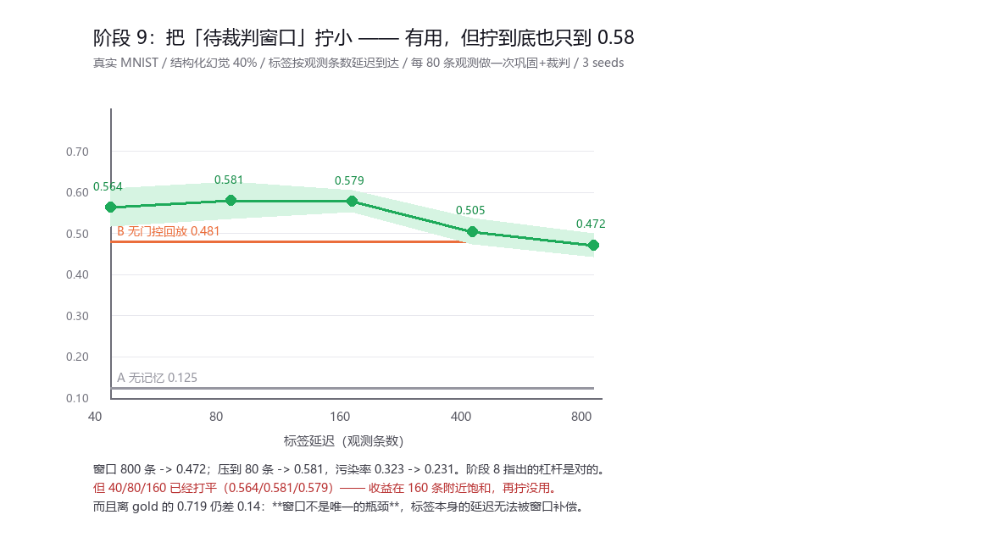
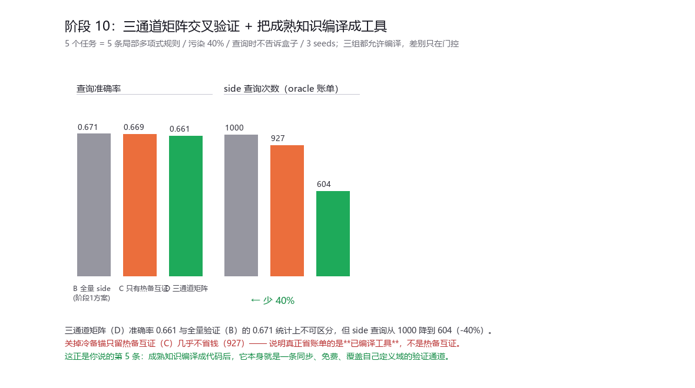

# 报告 · 阶段 9 / 10 —— 两条线并行

## 线一（阶段 9）：把「待裁判窗口」拧小

**背景**：阶段 8 的结论是"延迟标签的污染是结构性的，重新加权绕不开；
真正的杠杆是减少同时挂着的未裁判条目"。阶段 7 里这个残留是 404 条 = 整整一个任务，
因为标签按"任务"整批到达。

**做法**：把标签改成**按观测条数**延迟到达（现实里反馈本来就是一条条回来的），
窗口长度变成连续可调的旋钮。每 80 条观测做一次「巩固 + 事后裁判」。

| 标签延迟（条） | ACC | 待裁判残留 | 污染率 | 回滚撤回 |
|---|---|---|---|---|
| 40 | 0.564±0.047 | 148 | 0.233 | 168 |
| **80** | **0.581±0.045** | 158 | 0.231 | 361 |
| 160 | 0.579±0.026 | 184 | 0.249 | 702 |
| 400（≈阶段 7 的 delay1） | 0.505±0.032 | 261 | 0.291 | 1033 |
| 800 | 0.472±0.029 | 402 | 0.323 | 569 |
| 参照 B 无门控回放 | 0.481 | | | |
| 参照 A 无记忆 | 0.125 | | | |

- **阶段 8 指出的杠杆是对的**：窗口 800 → 0.472，压到 80 → 0.581；污染率 0.323 → 0.231。
  而且 delay=400（= 一个任务）复现了阶段 7 的 0.471~0.505 量级，说明实现没跑偏。
- **但收益在 160 条附近就饱和了**：40/80/160 三档打平（0.564/0.581/0.579），再拧没有增益。
- **而且离 gold 的 0.719 仍差 0.14** —— 窗口不是唯一瓶颈，标签本身的延迟无法被窗口补偿。

---

## 线二（阶段 10）：三通道矩阵交叉验证 + 把成熟知识编译成工具

**任务域**：5 个任务 = 5 条**局部多项式规则**，各自作用在 R^4 的一个盒子里；
观测污染 40%（脏样本的 y 是**另一条规则的合法输出**，所以是结构化噪声）；
查询时不告诉你是哪个盒子。

**三条通道**：

| 通道 | 检验方式 | 代价 |
|---|---|---|
| anchor（冷备） | 已编译工具在 x 处的预测与候选 y 是否相符；无工具覆盖则弃权 | 免费 |
| peer（热备互证） | **留一法**：用同批其他候选拟合一个函数，回头检验这一条 | 免费 |
| side（侧载） | 直接问环境要 x 的真值 | **要花预算** |

| 组 | 最终查询 ACC | side 查询次数 | 编译出的工具 |
|---|---|---|---|
| B_gold 全量 side 验证（阶段 1 方案） | 0.671±0.125 | **1000** | 6.0 |
| C_peer 只有热备互证 + 模糊时 side | 0.669±0.122 | 927 | 5.3 |
| **D_matrix 三通道矩阵** | **0.661±0.116** | **604（−40%）** | 5.7 |

**三通道矩阵在准确率统计上不可区分的前提下，把 oracle 账单砍掉了 40%。**

而且消融说清楚了钱是谁省的：**关掉冷备锚、只留热备互证（C），几乎一分钱不省（927 vs 1000）。**
真正省账单的是**已编译的工具** —— 它同步、免费、覆盖自己的定义域，
正好是阶段 5B 认定"唯一能落地"的那种信号。

---

## 对你那五条想法的逐条回应

| 你的想法 | 实测结果 |
|---|---|
| ① 冷备 × 热备交叉对比，**绕开温备** | 热备互证（留一法）单独用几乎不省钱（927 vs 1000）。它在**有锚的时候**才有价值 |
| ② 加一条完全侧载的验证方式 | 实现了（side 通道），但它本质就是**有代价的环境查询**；价值在于被编译逐渐替代 |
| ③ 侧载 × 冷备交叉对比提高正确率 | 就是 D 组：准确率没降，账单 −40%。**成立** |
| ④ 已知数据（冷备）也可能有错，需单独一套比对机制 | **这一条我这轮没有真正实现** —— 见下方缺口 |
| ⑤ **把成熟内容工具化，只存代码结构** | 成立，而且它是**唯一 load-bearing 的一条**：编译出的表达式成了免费验证通道，这是账单 −40% 的全部来源 |

### 缺口：锚审计（你的第 ④ 条）

"用新证据反查旧工具"这个机制我**没有做**。当前实现里冷备锚一旦编译就是不可质疑的，
compile 只用当批样本，从来不回头检查已冻结的工具。
所以如果第一条规则编译时就错了，它会一直错下去 —— 而这正是你指出的风险。

要做的话机制很清楚：**用后来到达的、多通道一致通过的样本去回测旧工具**，
拟合质量掉下来就把那个工具降级或重编译。这是一个具体的、可证伪的下一轮。

---

## 诚实边界

1. **阶段 10 的域是合成的**（局部稀疏多项式）。它"可编译"是我们故意选的性质 ——
   选它是因为它对应你说的"数学运算可以用代码实现"。真实知识（图像、语言）能不能编译成工具，
   **这轮完全没有回答**。
2. 阶段 10 只有 **5 个任务、3 个种子**，ACC 的标准差到 0.125，组间差异都在噪声里
   （唯一稳的是 side 查询次数，因为那是确定性的计数）。
3. TOL=0.25、RADIUS=1.1、ROUND=40、编译阈值 R2>0.995 都是随手定的，没扫。
4. B_gold 在阶段 10 里也用同一套"锚 → 最近邻"的预测路径，所以三组的差别**只在门控**，
   这是刻意的；但也意味着这个实验没有回答"工具比记忆好多少"（那由阶段 6 回答）。
5. 阶段 9 的 gold 参照（0.719）取自阶段 7，不是同一次跑的配对。
